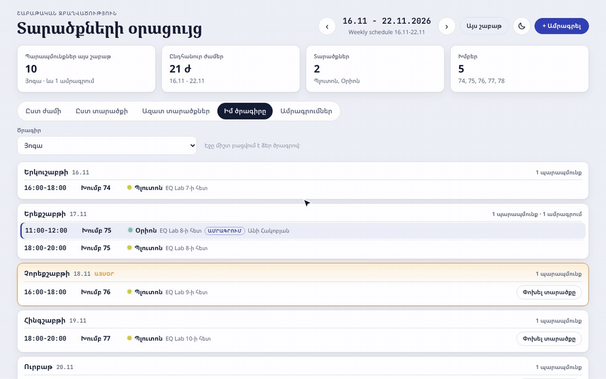
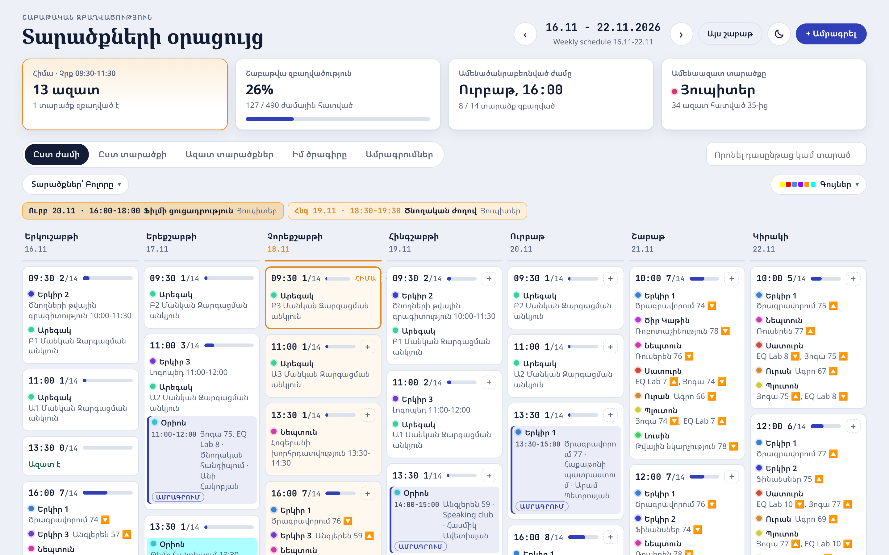
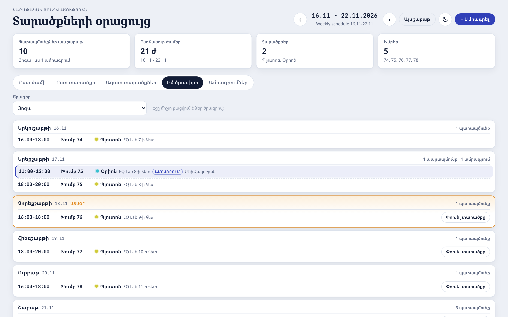
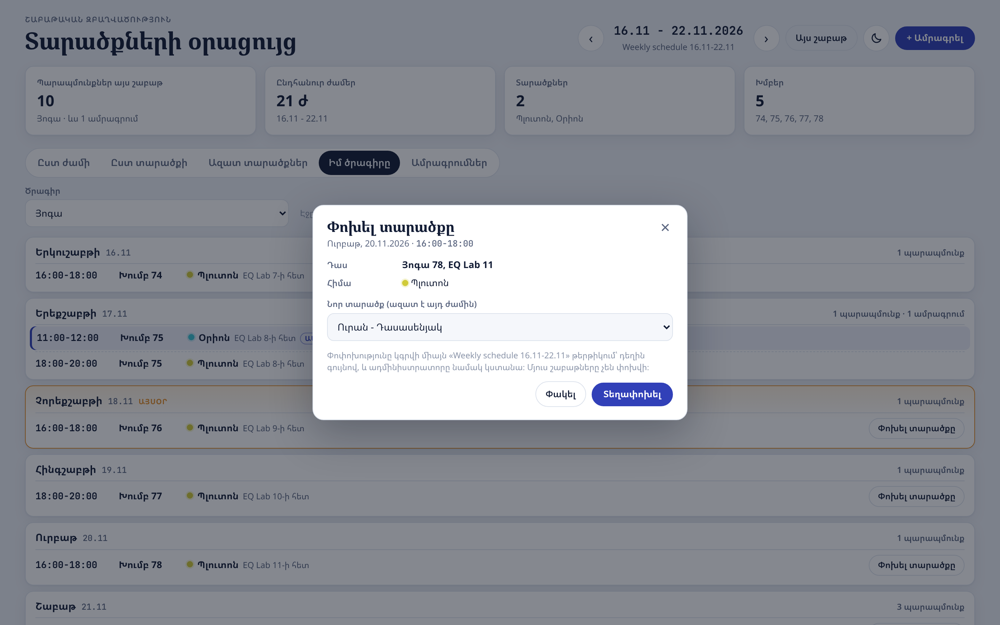
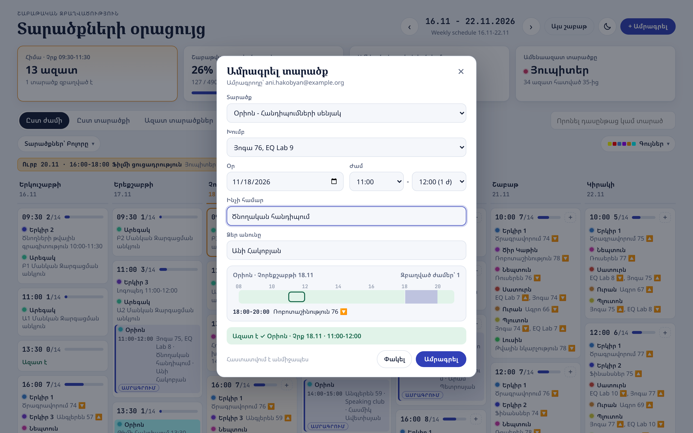
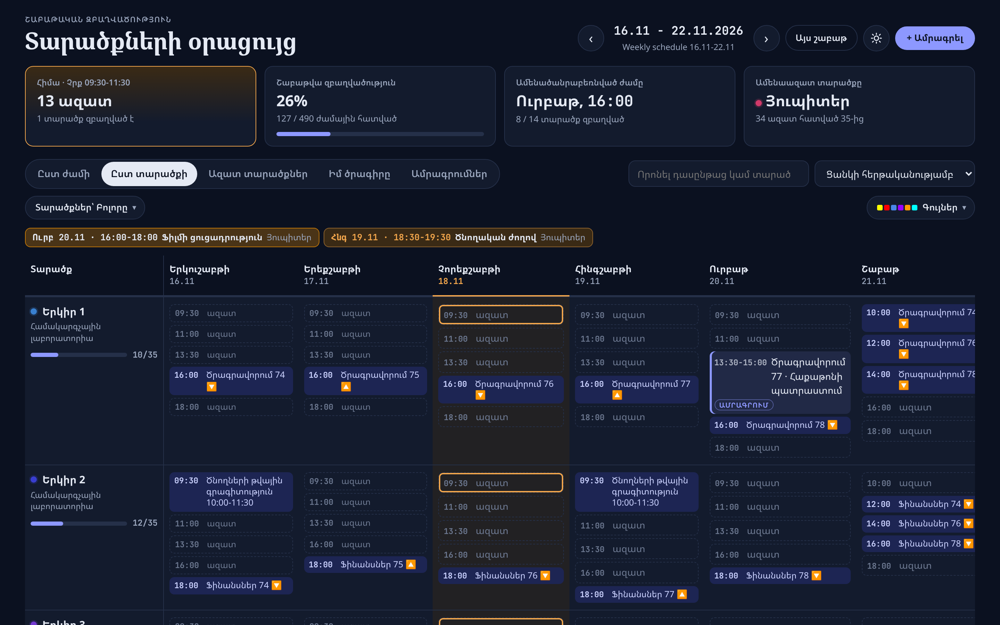
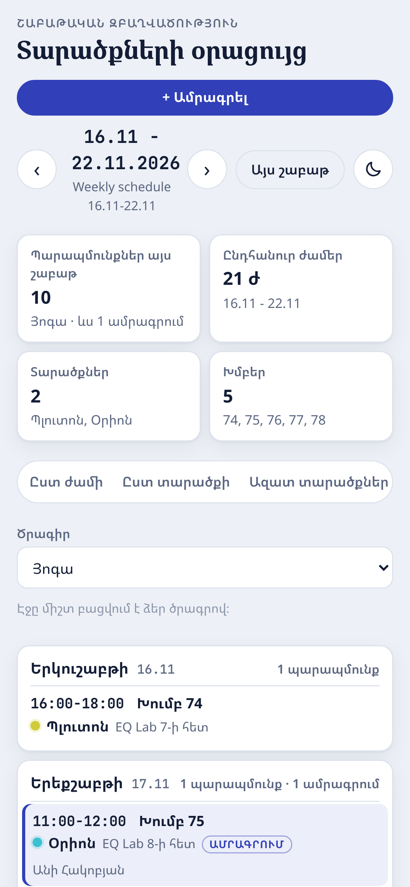
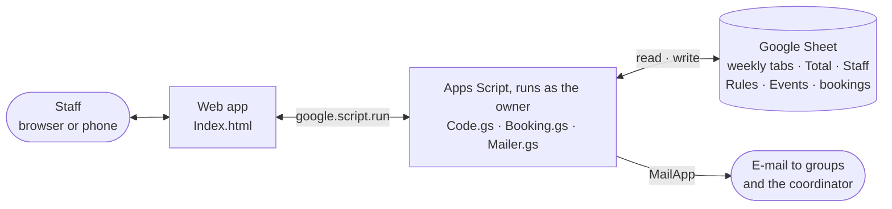

<h1 align="center">Timetable for SMART</h1>

<p align="center">
  Room timetable, room booking and room changes for the COAF SMART Center.<br>
  A Google Sheet stays the single source of truth; a small Apps Script web app makes it easy to read and use.
</p>

<p align="center">
  <a href="https://github.com/dstepanian/timetable-for-smart/actions/workflows/test.yml"></a>
  
  
  <a href="LICENSE"></a>
</p>

<p align="center">
  
</p>

> **Հայերեն.** «Տարածքների օրացույց»-ը ՍՄԱՐԹ կենտրոնի սենյակների շաբաթական բաշխվածության վեբ էջ է։ Աշխատակիցները տեսնում են, թե որ տարածքը երբ է զբաղված, էջը բացելիս միանգամից տեսնում են իրենց ծրագրի պարապմունքները, ամրագրում են ազատ սենյակ և կարող են իրենց խմբի դասը տեղափոխել այդ ժամին ազատ տարածք։ Տվյալները գալիս են Google Sheets աղյուսակից, էջն աշխատում է Google Apps Script-ով, իսկ փոփոխությունների մասին նամակները գնում են ավտոմատ։

## Why

The center plans its rooms in one Google Sheet: a grid of rooms by time slots, one tab per week, colours for room changes, cancellations and events. That works well for the coordinator, but it is hard to read for everyone else, especially on a phone. This app keeps the sheet exactly as it is and puts a fast, readable page in front of it, plus the few actions staff actually need.

## Features

- **Week at a glance.** Every slot of the week with the busy rooms, a live "now" card, the busiest hour and the freest room. Search, a room filter and the colour legend are one click away.
- **By room and free rooms.** One row per room for the whole week, or the list of rooms that are free at a chosen time.
- **My program.** Instructors land on their own program every time: days, hours, rooms, total hours and groups. Joint lessons (for example EQ Lab together with Yoga) show the partner group.
- **Booking.** Book a free room for one of your groups. The form checks the timetable and other bookings as you type, shows the day as a timeline, and can require the coordinator's approval. Your bookings can be cancelled from the «Ամրագրումներ» tab.
- **Room change.** An instructor moves a session of their own group to a room that is free at that time. Only that week's tab changes: the cell is moved, painted with the room-change colour and given a note; the coordinator gets an e-mail; every move is logged.
- **E-mails.** Groups are told about changes in their rooms (batched every 10 minutes), with an optional weekly digest and a test mode that sends everything to the coordinator only.
- **Fast.** The last schedule is kept gzipped in the script cache, so the page appears in about two seconds and then refreshes itself from the sheet.
- **Comfortable.** Light and dark theme, works on phones, fully in Armenian.

## Screenshots

<table>
  <tr>
    <td width="50%"></td>
    <td width="50%"></td>
  </tr>
  <tr>
    <td align="center"><b>Week view</b> (Ըստ ժամի)</td>
    <td align="center"><b>My program</b> (Իմ ծրագիրը), with joint lessons</td>
  </tr>
  <tr>
    <td></td>
    <td></td>
  </tr>
  <tr>
    <td align="center"><b>Room change</b>: only rooms free at that time are offered</td>
    <td align="center"><b>Booking</b> with a live check and a day timeline</td>
  </tr>
  <tr>
    <td></td>
    <td align="center"></td>
  </tr>
  <tr>
    <td align="center"><b>By room</b>, dark theme</td>
    <td align="center"><b>On a phone</b></td>
  </tr>
</table>

<sub>All names, groups and e-mail addresses in the pictures are made up (see <a href="scripts/demo-data.js">scripts/demo-data.js</a>).</sub>

## How it works



- The web app **executes as its owner** and is open to everyone in the Google Workspace domain, so staff never need access to the sheet itself. Who is using the page comes from their signed-in account.
- An **instructor** is anyone whose e-mail stands next to a group in the `Staff` tab. Instructors book rooms for their own groups and move their own sessions.
- An **administrator** is the address in the settings (several can be listed) or the script owner. Administrators approve or reject bookings and may move any session.
- Every write takes a script lock and is checked again on the server: the target room must be empty in the grid, free of bookings, and the session must not be in the past.

## The sheet

| Tab | What it holds |
| --- | --- |
| `Weekly schedule dd.mm-dd.mm` | One per week. Row 1: day names, row 2: slot start times. Column A: room, column B: a short description. Each cell holds the lesson, for example `Ծրագրավորում 74 🔼`; a lesson with its own hours (`Լոգոպեդ 11:00-12:00`) and several lines per cell are fine. Background colours follow `Rules`. |
| `Total` | The base timetable, shown for weeks that do not have their own tab yet. |
| `Rules` | The colour legend: a coloured cell and its label in each row. A label containing «տարածքի փոփոխություն» is the room-change colour; «միջոցառում» marks events. |
| `Staff` | `Group`, `Email 1`, `Email 2` in columns A:C, and the settings in E:F (below). A joint group can be written as `Յոգա 74, EQ Lab 7`. |
| `Events` (optional) | `Start Date`, `Subject`, `Start Time`, `End Time`, `Location`, for example exported from Google Calendar. |

The app creates and keeps its own tabs: `Ամրագրումներ` (bookings), `Տարածքի փոփոխություններ` (room-change log), and the hidden `Փոփոխությունների հերթ` (e-mail queue) and `Նամակների լոգ` (e-mail log).

### Settings (`Staff` tab, columns E:F)

| Setting | Example | Meaning |
| --- | --- | --- |
| Ադմինիստրատորի հասցե | `coordinator@example.org` | Administrator e-mail(s), comma separated |
| Շաբաթական նամակ (ON/OFF) | `OFF` | Weekly digest to every group, Monday 09:00 |
| Փոփոխությունների նամակ (ON/OFF) | `ON` | E-mail groups when their rooms change |
| Թեստային ռեժիմ՝ միայն ադմինիստրատորին (ON/OFF) | `ON` | Send every e-mail to the administrator only |
| Օրացույցի հղում | web app URL | Link placed in the e-mails |
| Ամրագրման հաստատում (ON/OFF) | `OFF` | Bookings wait for the administrator's approval |
| Ամրագրման ժամեր | `08:00-21:00` | Hours in which rooms can be booked |
| Ամրագրման տևողություն (ժամ) | `4` | Longest booking, in hours |
| Ամրագրում քանի օր առաջ | `60` | How many days ahead people may book |

## Setup

1. Open the spreadsheet and choose **Extensions → Apps Script**.
2. Create the files `Code.gs`, `Booking.gs`, `Mailer.gs` and the HTML file `Index`, and paste the contents from [`src/`](src). In **Project Settings** turn on "Show appsscript.json" and paste [`src/appsscript.json`](src/appsscript.json).
   With [clasp](https://github.com/google/clasp) instead: `clasp clone <scriptId> --rootDir src`, then `clasp push`.
3. **Deploy → New deployment → Web app**: execute as *Me*, access *Anyone within your organization*. Share that URL with staff.
4. Reload the sheet and use the new **Տարածքներ** menu: «Միացնել ավտոմատ ուղարկումը» turns on the change e-mails (and the weekly digest when it is ON). Keep test mode ON until the e-mails look right.

## Development

```bash
npm install
npx playwright install chromium
npm test              # server tests + browser tests
npm run screenshots   # rebuild docs/ from the made-up week (needs ffmpeg for the GIF)
```

- `test/gas-mock.js` is a small fake of `SpreadsheetApp`, `CacheService`, `MailApp` and friends. `test/server.test.js` runs the real `.gs` files against it.
- `test/ui.test.js` opens `src/Index.html` in Chromium and wires `google.script.run` to the same server code, so the page is tested end to end without Google.
- There is no build step: what is in `src/` is exactly what runs in Apps Script.

```
src/
  Code.gs          reading the sheet, cache, doGet
  Booking.gs       bookings, approval, room changes
  Mailer.gs        change e-mails, weekly digest, menu, triggers
  Index.html       the whole page: markup, styles and script
  appsscript.json  manifest
test/              mock, server tests, browser tests
scripts/           made-up demo week and the screenshot script
docs/              README pictures
```

## License

[MIT](LICENSE) © David Stepanyan
